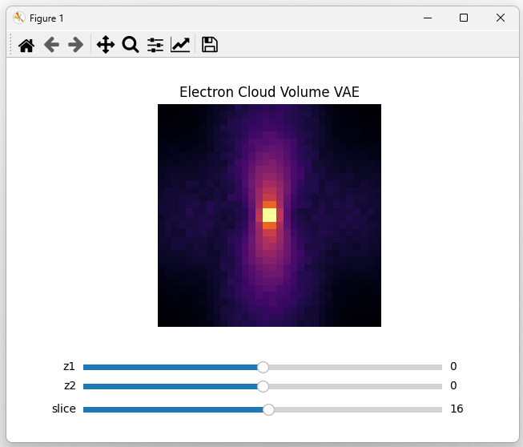

# Electron Cloud Volume VAE

This project demonstrates how to generate **3D electron cloud (atomic orbital) volume data** and train a **Variational Autoencoder (VAE)** to reconstruct the data.

After training, the latent variables can be interactively manipulated using GUI sliders, allowing you to observe changes in the internal structure of the electron cloud in real time.

This project is intended as an educational example for **quantum mechanics visualization**, **machine learning**, and **3D volume data processing**.



---

# Features

* Generate 3D electron cloud (volume) data
* Train a Variational Autoencoder (VAE) using PyTorch
* GPU (CUDA) acceleration for faster training
* Interactive GUI for real-time inference
* Explore the latent space using sliders
* Display arbitrary Z-axis slices of the reconstructed volume

---

# Requirements

* Python 3.10 or later
* Windows or Linux

### Tested Environment

* Windows 11
* Python 3.12

---

# Installation

Install the required packages:

```bash
pip install torch numpy matplotlib scipy
```

If you plan to use GPU acceleration, install the appropriate CUDA-enabled version of PyTorch for your environment.

---

# Usage

## Train the VAE

Run the following command to start training:

```bash
python electron_cloud_vae.py --train
```

After training completes, a trained model (`.pt` file) will be generated.

---

## Launch the GUI

Start the GUI using the trained model:

```bash
python electron_cloud_vae.py
```

The GUI provides the following interactive controls:

* Modify latent variables (`z1` and `z2`)
* Change the displayed Z-axis slice
* View the reconstructed electron cloud in real time

---

# Architecture

The project separates the training process from the inference GUI.

```text
Electron Cloud Generation
            │
            ▼
      PyTorch Training
            │
            ▼
     Trained Model (.pt)
            │
            ▼
      GUI Inference
            │
            ▼
      Slider Controls
            │
            ▼
 Electron Cloud Visualization
```

To improve maintainability and future extensibility, the application is designed using several **GoF (Gang of Four) design patterns**.

### Design Patterns Used

* Strategy
* Factory Method
* Facade
* MVC (Model-View-Controller)

---

# License

This project is released under the MIT License.

See the `LICENSE` file for details.

---

# Disclaimer

This software is provided as an educational and research-oriented sample implementation for studying machine learning and scientific visualization.

---

# Contributing

If you find this project useful, I'd appreciate it if you:

- ⭐ Star this repository
- 🍴 Fork it if you customize it
- 🐛 Report bugs via Issues
- 💡 Share ideas via Discussions

It is **not intended to be a physically accurate quantum mechanics simulator**.
