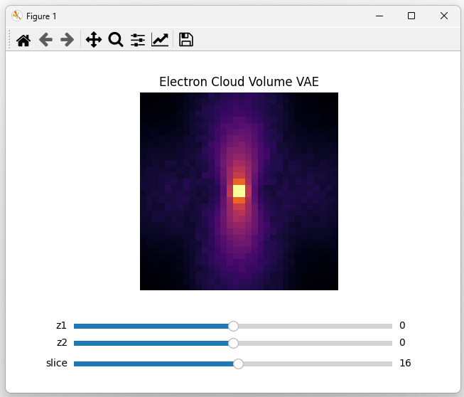

# Electron Cloud Volume VAE

3D電子雲（原子軌道）をボリュームデータとして生成し、**Variational Autoencoder (VAE)** によって学習・再構成するデモアプリケーションです。

学習済みモデルの潜在変数をGUIのスライダーで操作し、電子雲の内部構造をリアルタイムに観察できます。

本プロジェクトは、量子力学の教育や機械学習の可視化を目的としたサンプル実装です。



---

# 特徴

- 3次元電子雲（Volume Data）の生成
- PyTorchによるVariational Autoencoder (VAE) の学習
- GPU(CUDA)による高速学習に対応
- GUIによるリアルタイム推論
- 潜在変数（Latent Space）の可視化
- Z方向スライス表示

---

# 動作環境

- Python 3.10 以上
- Windows / Linux

動作確認環境

- Windows 11
- Python 3.12

---

# 必要ライブラリ

```bash
pip install torch numpy matplotlib scipy
```

GPUを使用する場合は、お使いの環境に対応したPyTorchをインストールしてください。

---

# 実行方法

## 学習

以下のコマンドを実行すると、VAEの学習を開始します。

```bash
python electron_cloud_vae.py --train
```

学習完了後、学習済みモデル（`.pt`ファイル）が生成されます。

---

## 推論（GUI）

学習済みモデルを使用してGUIを起動します。

```bash
python electron_cloud_vae.py
```

GUIが起動し、以下の操作ができます。

- z1・z2による潜在変数の変更
- Zスライス位置の変更
- 電子雲内部のリアルタイム表示

---

# アーキテクチャ

本プロジェクトでは、学習アプリケーションと推論GUIを分離しています。

```
電子雲生成
      │
      ▼
   学習（PyTorch）
      │
      ▼
 学習済みモデル(.pt)
      │
      ▼
 GUI推論
      │
      ▼
 スライダー操作
      │
      ▼
 電子雲表示
```

また、今後の機能追加を考慮し、GoFデザインパターンを取り入れた構成になっています。

採用している主な設計パターン

- Strategy
- Factory Method
- Facade
- MVC

---

# ライセンス

本プロジェクトは MIT License のもとで公開しています。

詳細は `LICENSE` を参照してください。

---

# 免責事項

本ソフトウェアは教育・研究・機械学習の学習を目的としたサンプル実装です。

本プロジェクトは厳密な量子力学シミュレーションを目的としたものではありません。

---

# コントリビューション

このプロジェクトが役に立つと感じたら、以下のことをしていただけると嬉しいです。

- ⭐ このリポジトリにスターを付ける
- 🍴 カスタマイズする場合はフォークする
- 🐛 Issues でバグを報告する
- 💡 Discussions でアイデアを共有する
